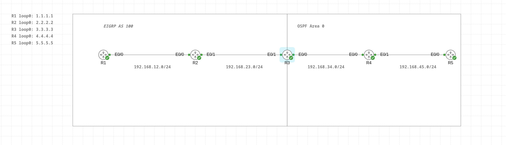

# EIGRP ↔ OSPF Redistribution Lab (CML)

## Goal
Connect an EIGRP AS 100 domain (R1–R3) and an OSPF Area 0 domain (R3–R5)
through mutual redistribution on R3, and verify full reachability.

## Topology

Links: 192.168.12.0/24, 192.168.23.0/24, 192.168.34.0/24, 192.168.45.0/24.
Loopbacks: R1–R5 use 1.1.1.1–5.5.5.5 /32.

## Design decisions
- Single redistribution point (R3) to avoid loops.
- Loopbacks of R1, R2 and R3 are brought in with `redistribute connected`;
  R4 and R5 advertise theirs with `network` statements. <!-- please confirm -->
- Seed metrics on R3: OSPF→EIGRP with delay 1, connected→EIGRP with delay 10.
  The delay difference explains the metric gap of 2304 (9 × 256) seen in R1's table.

## Verification
- Before redistribution: each side only knows its own protocol's routes
  (outputs in `verification.txt`).
- After: R1 sees D EX routes for 3.3.3.3–5.5.5.5; R5 sees O E2 routes
  for 1.1.1.1, 2.2.2.2 and 192.168.12.0/24.
- Pings with `source loopback0` between R1 and R5 succeed.

## Problems and lessons
1. 3.3.3.3 was missing on R1 after redistribution. Cause: `redistribute ospf`
   only takes routes installed by OSPF; R3's loopback is a connected route.
   Fix: add `redistribute connected` under EIGRP on R3.
2. Metric difference of 2304 between routes is explained by the seed delay values.

## Files
- [configs/](configs/): running configs of R1–R5
- `Redistribution.yaml`: CML topology export
- `verification.txt`: routing tables and ping results
